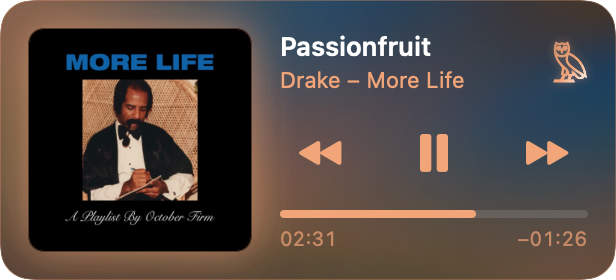
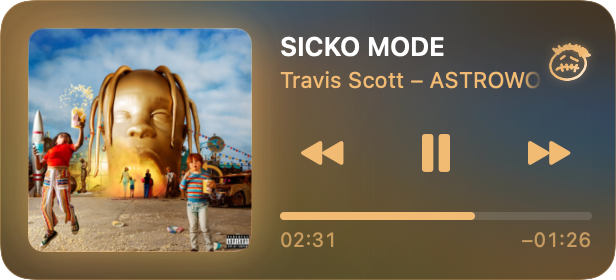
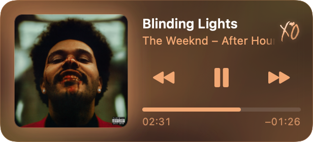

# Emblem

**A macOS menu bar Now Playing item that morphs into the artist's logo.**

Emblem replaces the system Now Playing item in the menu bar. When Spotify plays a track by one of its artists, as lead or featured artist, the icon traces itself into their logo: the OVO owl for Drake, the College Dropout bear for Kanye, the XO for The Weeknd, the Cactus Jack face for Travis Scott, the GOLF le FLEUR* flower for Tyler, the Creator, the Born Sinner crown for J. Cole, the metal mask for MF DOOM, the W for Wu-Tang Clan, the dagger for 21 Savage, the Blohsh figure for Billie Eilish, the broken heart for Lil Peep, the crown of thorns for Kendrick Lamar, and the Concrete Boys stick figure for Lil Yachty. For everything else it behaves like Apple's own player.


| Drake | Travis Scott | The Weeknd |
| --- | --- | --- |
|  |  |  |

<sub>Rendered by the app itself (`Emblem --render-covers`). Each player takes its colours from the album cover.</sub>

**Built with:** Swift, SwiftUI and AppKit, Swift Package Manager (no Xcode), AppleScript and distributed notifications for Spotify, a vendored MediaRemote adapter for other sources.

## Highlights

- **Logos drawn as paths and animated stroke by stroke.** Each logo was traced to vector path data, so the morph can shrink the play circle while revealing the logo's lines along their outlines, at any menu bar scale.
- **Careful artist matching.** "Drake Bell" isn't Drake. Artists must be a whole credit or appear after feat./ft./with, the lead artist wins, and because Spotify's notification names only the first artist, full credits come from the track's public embed page and are matched by Spotify artist ID.
- **Colours from the album, not the artist.** The player picks the cover's dominant colour (a hue histogram weighted by saturation, brightness and closeness to the centre) and builds a flowing mesh-gradient background from it.
- **A pixel-matched copy of Apple's player.** Layout, fonts, timings and the marquee were measured from the live system module through the Accessibility API, with small tools in `tools/`.

## Download

Open Terminal (press ⌘ Space, type "Terminal", press Return), paste this and press Return:

```bash
curl -fsSL https://github.com/aboodgitawaida/Emblem/releases/latest/download/install.sh | bash
```

Emblem installs, opens in your menu bar and starts at login. Play something in Spotify, and when macOS asks whether Emblem may control Spotify, click **Allow**.

**Without Terminal:** download **Emblem.dmg** from the [latest release](https://github.com/aboodgitawaida/Emblem/releases/latest), open it and drag Emblem into Applications. The first time you open it, macOS says it can't check the app for malware, because Emblem isn't notarized by Apple. Click **Done**, then open System Settings → Privacy & Security, scroll down and click **Open Anyway**. You only need to do this once.

Needs a Mac with Apple silicon (M1 or later), macOS 14 or later, and Spotify. To update, run the same command again. To uninstall, quit Emblem (right-click its icon → Quit) and drag it from Applications to the Bin.

## Build from source

```bash
./scripts/build-app.sh --install    # builds, installs to ~/Applications, launches
```

- Built with Swift Package Manager and Command Line Tools (Xcode isn't required).
- `scripts/build-adapter.sh` builds `vendor/mediaremote-adapter` without CMake. It's bundled into `Contents/Resources/adapter`.

## Adding an artist

Each artist is a folder in `Artists/` with an `artist.json` and a `logo.svg`, so adding one needs no code. You can
also drop folders into `~/Library/Application Support/Emblem/Artists/` without rebuilding. See
[ADDING_ARTISTS.md](ADDING_ARTISTS.md).

## Debug

```bash
.build/release/Emblem --selftest              # artist matcher cases
.build/release/Emblem --check-artists         # loads every artist folder and explains any problem
.build/release/Emblem --render-frames <dir>   # morph strip + player PNGs
.build/release/Emblem --fit-logo <svg>        # crops a logo's viewBox tight
tools/compare                                 # Emblem's player vs the system's, element by element
```

## How it works

- **Spotify** (`SpotifyMonitor`): listens to the `com.spotify.client.PlaybackStateChanged` distributed notification. AppleScript is used only for artwork, the initial state and controls.
- **Everything else** (`MediaRemoteMonitor`): uses the mediaremote-adapter stream via `/usr/bin/perl`. If its self-test fails, only non-Spotify sources are lost.
- **Artists** (`Artists/<id>/`): each artist is a folder with `artist.json` (names, Spotify artist ID, sizes, fallback palette) and `logo.svg`, loaded at launch by `ArtistLibrary`. The player's colours come from the playing album's art (`ArtworkPalette`). Drake → OVO owl, Kanye → College Dropout bear, The Weeknd → XO, Travis Scott → Cactus Jack face, Tyler, the Creator → GOLF le FLEUR* flower, J. Cole → Born Sinner crown, MF DOOM → his mask, Wu-Tang Clan → the W, 21 Savage → the dagger, Billie Eilish → the Blohsh figure, Lil Peep → the broken heart, Kendrick Lamar → a crown of thorns (drawn for Emblem), Lil Yachty → the Concrete Boys stick figure.
- **Artist detection** has two checks:
  - `ArtistMatcher`: the artist must be a whole credit in the artist field, or after feat./ft./featuring/with in the title. "Drake Bell" doesn't count. The lead artist wins when several brands are credited.
  - `SpotifyCredits`: Spotify's notification only names the first artist, so the full artist list comes from the track's public embed page (`open.spotify.com/embed/track/<id>`), matched by artist ID.
- **Log**: `~/Library/Logs/Emblem.log`.
- **Morph** (`StatusIcon`): renders template images frame by frame. The circle shrinks and fades while the logo's lines are revealed along their outlines.
- **Menu**: right-click the icon for Open at Login and Quit.

## Signing

`build-app.sh` signs with the self-signed **Emblem Local Signing** certificate in your login Keychain, so macOS permissions such as controlling Spotify survive rebuilds. To make one, open Keychain Access, choose Certificate Assistant → Create a Certificate, pick the "Code Signing" type and name it exactly that. If no such certificate exists, it falls back to ad-hoc signing, and macOS will ask for Spotify access again after every rebuild.

## Layout reference

The player copies the system Now Playing module's measured layout (see `Layout` in `PlayerView.swift`). To re-measure, give your terminal Accessibility access (System Settings → Privacy & Security), then:
- **Find menu bar items:** `tools/axat scan`
- **Open Apple's player:** `tools/axat press <x> <y>`
- **Dump its layout:** `tools/axat ccdump`
- **Dump Emblem's player:** `tools/axdump emblem`

Build the tools first, e.g. `swiftc -O tools/axat.swift -o tools/axat`.

## Requirements

- macOS 14 or later. Some effects need newer systems: the flowing background needs macOS 15, and the glass panel needs macOS 26. Older systems fall back to a flat panel.
- Command Line Tools only (no Xcode). Clone with `git clone --recursive` so the `mediaremote-adapter` submodule comes along.
- Spotify. The first time you play a track, macOS asks whether Emblem may control Spotify; allow it.

## Disclaimer

Emblem is an unofficial fan project. It is not affiliated with, endorsed by or sponsored by Apple, Spotify, OVO, or any of the artists or labels it shows. All logos, album artwork and names are the property of their respective owners (album covers in the screenshots are shown only to illustrate the app), and the logo files in `Resources/` and `Artists/` are redrawn from publicly circulated images for personal, non-commercial use. If you are a rights holder and want something removed, open an issue.

## Author

**Abood Awaida** · [GitHub](https://github.com/aboodgitawaida) · [LinkedIn](https://www.linkedin.com/in/abood-awaida/)

## More of my work

- **[Courseflix](https://github.com/aboodgitawaida/Courseflix)**: Netflix-style course discovery for UTM students, with reviews, recommendations and 2,600+ courses. [courseflix.ca](https://www.courseflix.ca)
- **[Vitals](https://github.com/aboodgitawaida/Vitals)**: heart rate from an ordinary webcam, measured entirely in the browser. [vitals-track.vercel.app](https://vitals-track.vercel.app)
- **[LotPulse](https://github.com/aboodgitawaida/LotPulse)**: live, student-reported parking enforcement alerts for UTM campus lots. [lotpulse-utm.vercel.app](https://lotpulse-utm.vercel.app)
- **[Basil](https://github.com/aboodgitawaida/Basil)**: a cosy pixel-art kitchen game that suggests recipes from what's in your fridge. [basil-cat.vercel.app](https://basil-cat.vercel.app)

## License

The code is [MIT](LICENSE). The artist logos, names and album artwork are not covered by that licence; they belong to their respective owners (see the disclaimer above).
