<p align="center">
  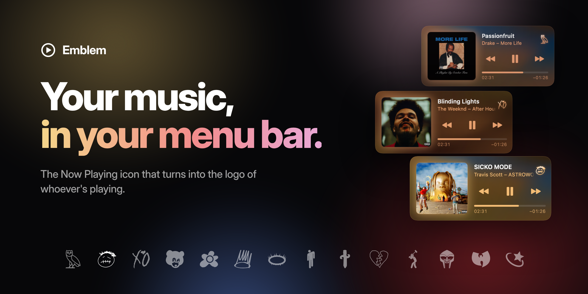
</p>

<p align="center">
  <a href="https://github.com/aboodgitawaida/Emblem/releases/latest"></a>
  
  
  
  
</p>

<p align="center"><b>Play a song. Watch your menu bar become the artist.</b></p>

Emblem replaces your Mac's Now Playing icon. Put on Drake and it traces itself into the OVO owl. Skip to Travis and it morphs into the Cactus Jack face. Click it and you get a player tinted in the colours of whatever album is on, with a background that flows in colours pulled straight from the cover art.

## Get Emblem

Open **Terminal** (press **⌘ Space**, type `Terminal`, press **Return**), paste this, and press **Return**:

```bash
curl -fsSL https://github.com/aboodgitawaida/Emblem/releases/latest/download/install.sh | bash
```

That's it. Emblem shows up in your menu bar a few seconds later and starts on its own every time you log in.

If you use Spotify, the first time a song plays your Mac asks if Emblem can control Spotify. Click **OK** (or **Allow**) so the play, pause and skip buttons work. Apple Music just works.

> **Needs:** a Mac with Apple silicon (M1 or newer), macOS 14 Sonoma or newer, and Spotify or Apple Music.

## The player

Every album gets its own look. The colours come straight from the cover, so *ASTROWORLD* is gold, *IGOR* is pink and *Graduation* is purple. Black-and-white covers like *Scorpion* get a silver player.

<p align="center">
  
  
  
</p>

<p align="center">
  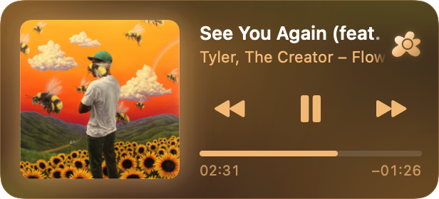
  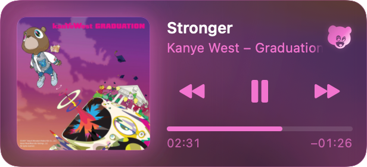
  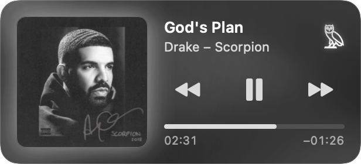
</p>

<p align="center">
  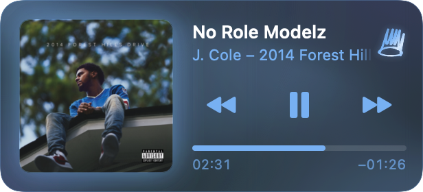
  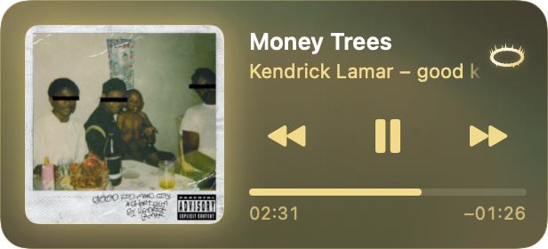
  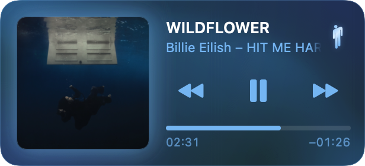
</p>

<p align="center">
  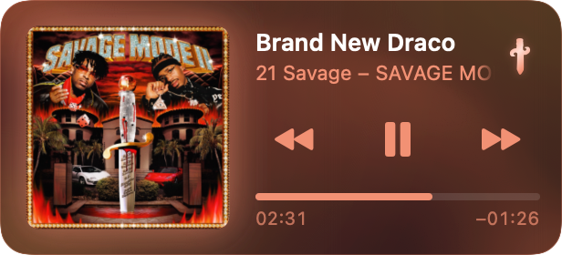 i was" width="32%">
  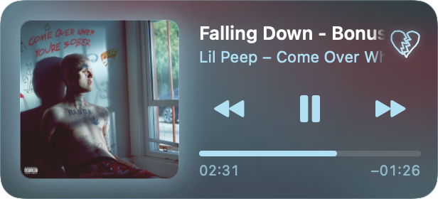
  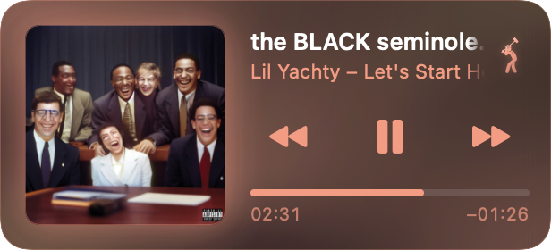
</p>

<p align="center">
  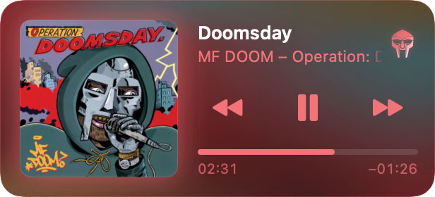
  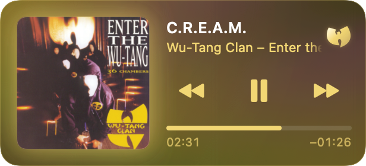
  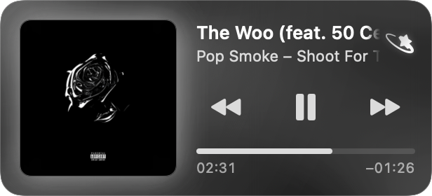
</p>

- **The morph.** Each logo draws itself line by line as the play button fades out, then a streak of light glints across it.
- **Living colour.** The player's background slowly flows in the album's colours (on macOS 26 it's real glass).
- **Tilt and shine.** The cover tilts toward your cursor, and the corner logo has a foil shine that follows it.
- **Everything else, untouched.** For other artists, Apple Music or YouTube in your browser, Emblem looks and works exactly like Apple's own player.

It works on features too: if one of your artists is on someone else's track, you'll see their logo.

**Want someone added?** [Request an artist →](https://github.com/aboodgitawaida/Emblem/issues/new?template=artist-request.yml)

## Questions

<details>
<summary><b>Is it safe to paste a command into Terminal?</b></summary>
<br>
Good instinct to ask. The command downloads the <a href="scripts/install.sh">install script</a> from this repo and runs it. It's short and readable: it checks your Mac, downloads Emblem, puts it in Applications and opens it. It doesn't ask for your password and doesn't touch anything else.
</details>

<details>
<summary><b>Why Terminal and not a normal download?</b></summary>
<br>
Emblem isn't distributed through Apple, so a downloaded copy gets a "can't be checked for malware" warning that sends you digging through System Settings. The one-line install skips all of that.
</details>

<details>
<summary><b>Why does it ask to control Spotify?</b></summary>
<br>
That's how the play, pause and skip buttons work, and how Emblem gets the album art. It only talks to Spotify on your Mac.
</details>

<details>
<summary><b>Does it work with Apple Music or YouTube?</b></summary>
<br>
Apple Music, yes, logos and all. YouTube and other music in your browser get the normal Now Playing player, without logos.
</details>

<details>
<summary><b>Does it work on Intel Macs?</b></summary>
<br>
Not yet. It needs an M1 or newer.
</details>

<details>
<summary><b>How do I update it?</b></summary>
<br>
Run the same install command again. It replaces the old version.
</details>

<details>
<summary><b>How do I remove it?</b></summary>
<br>
Paste this into Terminal:

```bash
curl -fsSL https://github.com/aboodgitawaida/Emblem/releases/latest/download/install.sh | bash -s uninstall
```
</details>

<details>
<summary><b>Something's not working</b></summary>
<br>
<a href="https://github.com/aboodgitawaida/Emblem/issues/new?template=bug-report.yml">Report it here</a>. It helps to include your macOS version and the song that was playing.
</details>

## For developers

Emblem is a native Swift app built with SwiftUI and AppKit. The player was measured against Apple's own through the Accessibility API, so it matches to the point. Artists are plain folders with a JSON file and an SVG, so [adding one](ADDING_ARTISTS.md) needs no code. Building, debugging and how it all works: **[docs/DEVELOPMENT.md](docs/DEVELOPMENT.md)**.

## Disclaimer

Emblem is an independent fan project. It is **not** affiliated with, endorsed by or sponsored by Apple, Spotify, OVO, or any of the artists or labels it shows. All logos, album artwork and names belong to their respective owners (album covers in the screenshots are shown only to illustrate the app), and the logo files in `Resources/` and `Artists/` are redrawn from publicly circulated images for personal, non-commercial use. If you are a rights holder and want something removed, [open an issue](https://github.com/aboodgitawaida/Emblem/issues) and it will be taken down.

## Made by

**Abood Awaida** · [GitHub](https://github.com/aboodgitawaida) · [LinkedIn](https://www.linkedin.com/in/abood-awaida/)

<details>
<summary>More of my work</summary>
<br>

- **[Courseflix](https://github.com/aboodgitawaida/Courseflix)**: Netflix-style course discovery for UTM students, with reviews, recommendations and 2,600+ courses. [courseflix.ca](https://www.courseflix.ca)
- **[Vitals](https://github.com/aboodgitawaida/Vitals)**: heart rate from an ordinary webcam, measured entirely in the browser. [vitals-track.vercel.app](https://vitals-track.vercel.app)
- **[LotPulse](https://github.com/aboodgitawaida/LotPulse)**: live, student-reported parking enforcement alerts for UTM campus lots. [lotpulse-utm.vercel.app](https://lotpulse-utm.vercel.app)
- **[Basil](https://github.com/aboodgitawaida/Basil)**: a cosy pixel-art kitchen game that suggests recipes from what's in your fridge. [basil-cat.vercel.app](https://basil-cat.vercel.app)
</details>

## License

The code is [MIT](LICENSE). The artist logos, names and album artwork are not covered by that licence; they belong to their respective owners (see the disclaimer above).
